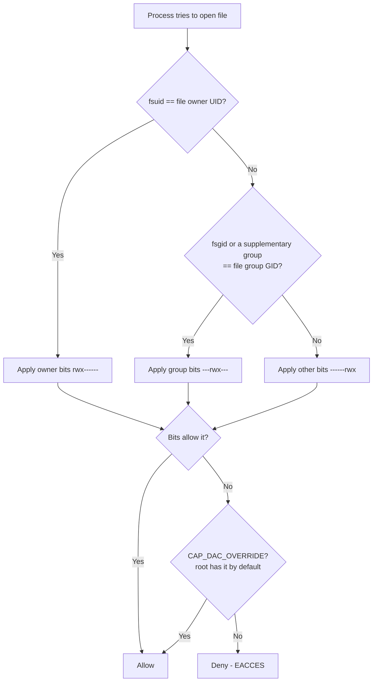

# Users

The kernel has never heard of `valen`. It knows UID 1000. All permission decisions - who can read this file, who can kill that process, who can bind to this port - are made on numbers, not names. The mapping from names to numbers in `/etc/passwd` is purely for human consumption; the kernel never touches it.

## UIDs and what the kernel tracks

Every process carries three UIDs:

| UID type | Purpose |
|---|---|
| Real UID (ruid) | Who owns this process |
| Effective UID (euid) | What permissions it actually runs with - this is what the kernel checks |
| Saved UID (suid) | Allows controlled transitions back to a previous privilege level |

Most of the time all three are the same. They come apart when a setuid binary runs - `sudo` is the obvious example - or when a process deliberately drops privileges.

## Root is UID 0, and UID 0 is a bundle of capabilities

There's no special kernel mode for root. Root is a UID, hardcoded as 0, and root processes run in ring 3 like everything else. Early Linux really did have conditionals scattered through it: `if (euid == 0) skip this check`. That stopped being the whole thing in Linux 2.2.

Since then the kernel checks capabilities, not UID 0. Root's power is split into about forty separate privileges, and each check asks for the one it needs:

| Root can... | because it holds |
|---|---|
| read or write any file | `CAP_DAC_OVERRIDE` |
| kill any process | `CAP_KILL` |
| load kernel modules | `CAP_SYS_MODULE` |
| bind to ports below 1024 | `CAP_NET_BIND_SERVICE` |
| `chroot` | `CAP_SYS_CHROOT` |
| `mount` | `CAP_SYS_ADMIN` |
| set the system clock | `CAP_SYS_TIME` |

UID 0 still matters because when a process runs a program as UID 0, the kernel hands it the full set. That's a default, not a law, and it comes apart in both directions:

- A process can keep UID 0 and drop capabilities. Root inside a container usually runs with a trimmed set, which is why it can't load a kernel module.
- A normal user's process can hold one capability and nothing else. `setcap cap_net_bind_service=+ep ./server` lets that binary bind port 80 without ever being root.
- User namespaces (complete since Linux 3.8) go further: UID 0 inside the namespace maps to an ordinary UID outside it. A rootless container's root is your own UID on the host, and its capabilities only count for resources the namespace owns.

To see what a process actually holds: `grep Cap /proc/$$/status`, then `capsh --decode=<mask>` on a mask.

## How file permissions work

Every inode stores an owner UID, a group GID, and nine permission bits. When a process opens a file, the kernel walks a simple decision tree:

Three details the simple version hides:

- The IDs checked are the filesystem UID and GID (fsuid, fsgid). They follow the effective IDs unless a program changes them with `setfsuid()`, which almost nothing does, so in practice it's the euid.
- Group means any of your groups: the primary one and every supplementary group `id` lists after `groups=`. That's why adding yourself to a group gives access, after you log in again.
- Root doesn't skip the check, it fails it and then gets let through by `CAP_DAC_OVERRIDE`. Even that has a limit: executing a file needs at least one `x` bit set somewhere.

Signals have their own rule: you can send `SIGKILL` to a process when your real or effective UID matches its real or saved UID. Anything else needs `CAP_KILL`, which root has.

## sudo and why it's different from being root

`sudo` is a setuid binary - when you execute it, its effective UID becomes 0 regardless of who's running it. It then checks `/etc/sudoers` to decide whether to actually let you run something as root. If yes, it runs the command. The whole thing is logged.

Running permanently as root is different. There's no logging, no friction, no per-command authorization. Every command runs with full privileges. Every typo, every script, every tool you invoke runs as root. The blast radius of a mistake is the entire system.

The principle of least privilege is the answer to this: run with only the access you actually need. It's why services have their own unprivileged users - `www-data`, `postgres`, `nobody`. If a web server process gets compromised, the attacker gets `www-data`'s access, which can't touch `/etc/shadow` or load kernel modules. That's the point.

## exam-note

> [!exam] LFCA
> Users = UIDs. Root = UID 0, hardcoded. The kernel checks effective UID for permission decisions, and capabilities for privileged ones; UID 0 gets them all by default. `sudo` gives temporary, logged root access per command. Principle of least privilege: run with minimum necessary permissions.

## Related

- [[user-space-vs-kernel-space]]
- [[kernel-overview]]
